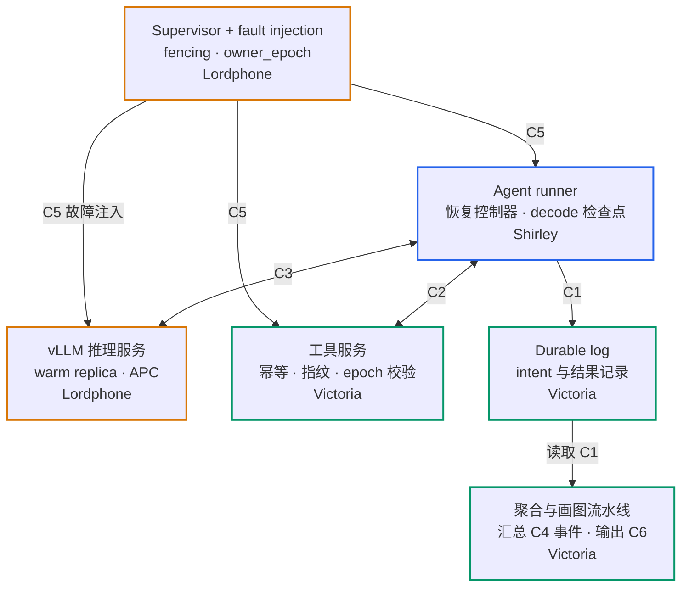

# OutcomeServe 任务分配 v2

Shirley Li · 2026-10-27

> 本文件取代 PR #1 的六周分工（Six-Week Work Distribution）；旧版可在 git 历史中查看。

## midterm 前的任务

midterm 是 11/4，期末是 12/4，从今天算只剩 8 天和约 5.5 周。分工按方案 A 执行，每人负责一个研究问题；midterm 前先完成下面几件事。

- [ ] **全员：** 回复每周可投入的小时数，以及对自己分到的研究问题和模块有没有异议（截止 Oct 28, 2026）
- [ ] **Victoria：** 起草 C1 durable log schema 和 C2 工具服务 API（截止 Oct 29, 2026）
- [ ] **Lordphone：** 完成 Week 1 spike，交一页报告和原始数据；这是 midterm 的主要实验结果（截止 Oct 30, 2026）
- [ ] **Shirley：** 根据 spike 定 RQ2 范围并通知大家；加 CODEOWNERS；建决策日志（截止 Oct 31, 2026）
- [ ] **全员：** 最小端到端链路在 CPU 上跑通 PRE\_DISPATCH 和 POST\_TOOL\_COMMIT\_PRE\_RESULT\_LOG 两种故障边界（截止 Nov 2, 2026）
- [ ] **全员：** midterm 各自小节交给 Shirley（截止 Nov 3, 2026）；Shirley 统稿并提交（截止 Nov 4, 2026）

## 为什么调整分工

proposal 里的分工按组件切，带来三个结构性问题；改为按研究问题切可以一起解决。

1. **耦合切在了人与人之间。** log schema 决定 recovery controller 怎么写，却分属两人；性能 benchmark 测的是另一个人写的 vLLM 集成和 re-prefill 路径。原则应该是：测哪条路径的人，就负责那条路径。
2. **关键路径集中在一个人身上。** 协调、第 3 周的 vLLM 集成和第 5 周的 recovery controller 都在同一人名下，任何一处延误都会阻塞全组。
3. **研究内容分布不均。** 新机制都在一个人名下。[课程要求](https://llmsystem.github.io/llmsystem2026fall/docs/Projects)期末报告里每人的贡献具体到文件和函数，所以每个人都需要一个能独立写成结果小节的研究问题。

另外，telemetry schema 和 metric aggregation 也分属两人，指标归属需要定一个明确的 owner。

## 研究问题调整（待 spike 验证）

原研究问题有两处会让结果失去说服力，新分工按调整后的研究问题设计。下面的判断基于估算，spike 实测后再定最终范围。

- **crossover 问题会退化。** restart 重跑到第 k 步时，同样要 prefill 这段上下文，还要重新 decode 所有生成的 token。它的工作量是 resume 的超集，ΔT(L, k) 几乎恒为正，heatmap 会是一片颜色。改为真正有取舍的问题：重算 vs 从 CPU / NVMe 恢复 KV；生成中途 crash 时 decode 检查点的间隔。
- **关掉 prefix caching（APC）会偏向我们自己。** vLLM V1 默认开启 APC。关闭后 restart 每一步都要全量 prefill，成本被放大；failure-free 基线变慢，logging 开销也被稀释。改为实验因子，并按故障域拆开：只挂 runner、推理进程冷重启、切到 warm replica。
- **补上 serving 维度。** 单 GPU 冷启动时，startup 会压倒 prefill，结果只反映 vLLM 的启动时间。主配置改为 warm replica failover，并发维度 N ∈ {1, 4, 16, 32} 视时间而定（Could）。
- **实现小修。** `max_model_len` 从 16384 改为 32768（16K 前缀之后几乎没有生成空间）；明确 Qwen3 的 `enable_thinking` 取值和多轮历史裁剪规则；回放走 completions 接口的 token ID。

调整后的三个研究问题：

- **RQ1 正确性：** 在所有故障边界下，支持幂等的工具做到零重复、零孤儿副作用；不支持的确定性地停下来。
- **RQ2 恢复路径：** 重算、warm failover、KV 恢复、decode 检查点，哪种在什么上下文长度和并发下最快。
- **RQ3 协议与成本模型：** 端到端协议的 failure-free 开销有多大；一次 crash 的成本由哪些部分组成，能否被模型预测。

## 研究问题归属（方案 A）

每人负责一个研究问题，并独立写期末报告里对应的结果小节。

| 研究问题 | Owner | 报告章节 | 核心指标 | 主要图表 |
| --- | --- | --- | --- | --- |
| RQ1 正确性 | Victoria | 正确性结果 | 重复 / 孤儿副作用数、tool-state mismatch、unsafe retry 率、false abstain 率、任务成功率 | 故障边界 × 方法的正确性矩阵 |
| RQ2 恢复路径与 serving 性能 | Lordphone | 恢复性能结果 | 恢复时间分解（startup / reconcile / prefill）、p95 crash-to-next-token、（Could）并发下的尾延迟 | 按故障域的恢复时间堆叠柱；（Could）p95 随并发 N 的变化；（Could）ΔT(L, 存储层级) |
| RQ3 协议与成本模型 | Shirley | 方法、协议与成本分析 | failure-free 开销、丢失工作量（decode 等价 token）、成本模型预测误差 | 协议状态机图；decode 检查点间隔的取舍曲线；预测 vs 实测 |

Shirley 另外负责项目协调、引言 / 相关工作 / 方法总述和统稿。集成周和重跑实验大家一起做，但每个实验只有一个 owner。

## 模块 owner / reviewer

每个模块一个 owner、一个 reviewer；reviewer 原则上是这个模块的主要使用方，每人 review 4–5 个模块。目录是建议，第一次 PR 时再定。

| 模块 | Owner | Reviewer | 建议目录 | 可用日期 |
| --- | --- | --- | --- | --- |
| Agent runner（token-ID 回放、canonical prefix） | Shirley | Victoria | `outcomeserve/runner/` | 11/1 |
| Recovery controller（prepare / reconcile / commit / abstain 状态机） | Shirley | Victoria | `outcomeserve/recovery/` | 11/2 骨架，11/15 完整 |
| Decode 检查点（runner 侧流式落盘） | Shirley | Lordphone | `outcomeserve/runner/` | 11/22 |
| 成本模型与分析 | Shirley | Lordphone | `analysis/costmodel/` | 11/22 |
| vLLM 服务侧（启动、APC 配置、warm replica、可选 KV 恢复） | Lordphone | Shirley | `outcomeserve/serving/` | 11/8；warm replica 11/15 |
| Supervisor 与 fencing（owner\_epoch） | Lordphone | Victoria | `outcomeserve/supervisor/` | 11/15 |
| Fault injection | Lordphone | Victoria | `outcomeserve/faults/` | 11/1 最小版，11/8 完整 |
| Telemetry 事件与 GPU 采样 | Lordphone | Victoria | `outcomeserve/telemetry/`、`schemas/` | 10/30 spike 用，11/8 完整 |
| 工具服务（幂等、请求指纹、epoch 校验、查询 API） | Victoria | Shirley | `outcomeserve/tools/` | 11/1 最小版，11/8 完整 |
| Durable log | Victoria | Shirley | `outcomeserve/log/` | 11/1 最小版，11/15 完整 |
| Workloads（合成任务、paired 案例；τ-bench 为 Could） | Victoria | Shirley | `workloads/` | 11/8 |
| Verifier 与 invariant checker | Victoria | Lordphone | `outcomeserve/verify/` | 11/1 |
| 聚合与画图流水线 | Victoria | Lordphone | `analysis/pipeline/` | 11/15 |

仓库里已有的 `docs/infrastructure/`、`schemas/` 和 `scripts/validate_week1_contracts.py` 归入 Lordphone 的 supervisor、fault injection 和 telemetry 模块，由他 review 后继续维护。

## 跨人接口合约

6 个跨人接口在 11/11 前写成合约（midterm 链路用到的 C1、C2、C5 先交），由 owner 起草、使用方 review；之后任何改动都走 PR，并升 `schema_version`。表中的记录类型和事件名都是建议名。

每条跨人连线都由一份合约约束；边框颜色表示 owner（蓝 Shirley、橙 Lordphone、绿 Victoria）。

所有组件都按 C4 发 telemetry 事件，图中省略了这些连线；C6 是聚合流水线输出的结果表格式。

| 合约 | Owner | 使用方 | 必须定义 | 截止 |
| --- | --- | --- | --- | --- |
| C1 Durable log schema | Victoria | Shirley（controller）、Lordphone（telemetry 关联） | 记录类型：STEP\_PREPARED、TOOL\_RESULT\_COMMITTED、CONTEXT\_COMMITTED、GEN\_CHECKPOINT、RECOVERY\_ABSTAIN；字段：task\_id、step\_id、op\_id、owner\_epoch、参数指纹、token\_ids、model\_revision；追加的原子性和 epoch 校验 | 10/29 |
| C2 工具服务 API | Victoria | Shirley | `submit(op_id, args, epoch)` 和 `query(op_id)` 的返回值：COMMITTED / NOT\_COMMITTED / UNKNOWN / STALE\_EPOCH / FINGERPRINT\_MISMATCH；每个工具的能力元数据：是否幂等、可否查询、去重窗口 | 10/29 |
| C3 Runner ↔ 推理服务 | Lordphone | Shirley | completions 接口的 token-ID 输入与流式输出；canonical prefix 规则（Qwen3 thinking 裁剪）；readiness 与 endpoint 切换；APC 开关 | 11/8 |
| C4 Telemetry 事件 | Lordphone（已有 `schemas/telemetry-event.schema.json`） | 全员产出事件，Victoria 聚合 | 新增事件：GEN\_CHECKPOINT\_WRITTEN、FAILOVER\_STARTED / FINISHED、KV\_RESTORE\_STARTED / FINISHED | 11/8 |
| C5 Fault injection | Lordphone（已有 `schemas/fault-injection.schema.json`） | Shirley（controller 回报前置条件）、Victoria（工具服务实现 DROP\_ACKNOWLEDGMENT） | 每个故障边界由哪个进程确认前置条件；新增故障域字段：runner / 推理进程 / 推理进程 + warm replica | 10/31 最小版，11/8 完整 |
| C6 结果数据格式 | Victoria | 全员 | run 级结果表的列；invalid run 的标记和原因；每张图对应的生成脚本 | 11/11 |

## Week 1 spike

spike 由 Lordphone 负责、Shirley review，1–2 天完成；它测出来的数据决定 RQ2 做多大，也是 midterm 报告的主要实验结果，所以 10/30 必须交。

1. 在 PSC 的 H100 上用 Apptainer 拉取锁定的 vLLM 镜像，启动 Qwen3-4B，`max_model_len` 设为 32768。
2. 权重放在节点本地盘，测冷启动时间，拆成进程启动、权重加载、编译与 CUDA graph、readiness 四段。
3. 测 2K / 8K / 16K 前缀的 prefill 时间，APC 开、关各一次；APC 开时再测同一前缀第二次请求的时间。
4. 测单流 decode 速度（tok/s），thinking 开、关各一次，记录典型的生成长度。
5. 跑一个 10 步的脚本化 agent 循环，在中途 `kill -9` 推理进程；再单独测一次只 kill runner 的情况。
6. 每个测量点至少重复 5 次，按现有 telemetry 格式记录。

交付物是一页 spike 报告加原始数据，建议放在 `experiments/spike/`。spike 交付后，Shirley 按下表定 RQ2 范围并通知大家：

| 如果 spike 显示 | 那么 |
| --- | --- |
| 冷启动时间远大于 16K prefill 时间 | warm replica failover 作为主配置，冷启动只作对照 |
| decode 吞吐远低于 prefill 吞吐 | decode 检查点保留在 Should |
| APC 开启时第二次请求的 prefill 明显变快 | 故障域拆分作为 RQ2 主线，APC 作为必报因子 |
| 只 kill runner 时，恢复几乎只剩 reconcile | runner crash 只作对照组，不单独深挖 |

## 计算资源（PSC Bridges-2）

所有报告里的 GPU 数字都用 Bridges-2 的 H100；V100 跑不了我们锁定的环境，不用于 GPU 实验。节点信息来自 [PSC 公告](https://www.psc.edu/?p=238269)和 [ACCESS 资源页](https://support.access-ci.org/documentation/resources/psc-bridges-2-gpu-bridges-2-gpu)。

| 节点类型 | 用途 | 原因 |
| --- | --- | --- |
| `h100-80`（每节点 8 × H100 80GB） | 主平台：所有报告里的 GPU 数字 | 支持 BF16，显存充足 |
| `l40s-48`（L40S 48GB） | 备选：H100 排队影响进度时用 | 支持 BF16，也是 proposal 原定的 GPU；数据单独报告，不和 H100 混合 |
| `v100-32` / `v100-16` | 不用于 GPU 实验 | 不支持 BF16；社区反馈 vLLM 0.20 起的预编译版本已不支持 V100（sm\_70），我们锁定的是 0.32 |

- 作业脚本必须显式写 `--gpus=h100-80:1`（warm replica 写 `:2`）；不写类型会默认分到 V100。
- 用 GPU-shared 分区，一个 job 最多 4 块 GPU；warm replica 在同一个 job 里起两个 vLLM 实例，各占一块。
- PSC 上不能用 Docker：用 Singularity / Apptainer 按 digest 拉取锁定的 vLLM 镜像。
- 测冷启动前把模型权重拷到节点本地盘；从共享文件系统加载的冷启动另测一次，两者分开报告。
- telemetry 里额外记录节点名和 Slurm job ID。

- [ ] **Lordphone：** 更新 `infra/environment.lock.json` 和 `docs/infrastructure/environment.md`，主平台改为 H100，L40S 为备选（截止 Oct 29, 2026）
- [ ] **Lordphone：** 写好 H100 的 Slurm 作业脚本和 Apptainer 镜像，spike 直接用（截止 Oct 29, 2026）
- [ ] **Shirley：** 确认 PSC allocation 的剩余额度，以及 H100 和 L40S 的计费方式（截止 Oct 29, 2026）

## 新时间表

midterm 是 11/4，期末是 12/4，时间表分三段：midterm 冲刺（到 11/4）、主体实验（到 11/25 代码冻结）、写作（到 12/4）。感恩节（11/26–11/27）只安排写作。

集成关卡（10/26–12/4）：spike 撑起 midterm，11/25 代码冻结后只写作。

| 日期 | 关卡 |
| --- | --- |
| 10/30 | spike 完成 |
| 11/2 | 最小链路跑通 |
| **11/4** | **midterm** |
| 11/15 | 5 种故障边界正确性全绿 |
| 11/22 | GPU 主实验完成 |
| 11/25 | 代码冻结 |
| 11/26–11/27 | 感恩节，只安排写作 |
| **12/4** | **期末提交** |

11/2 的最小链路是分界线：跑通了，midterm 带两种故障边界的正确性结果；跑不通，midterm 只报 spike 的测量结果和设计。

| 时间 | Shirley | Lordphone | Victoria |
| --- | --- | --- | --- |
| 10/27–11/1 | 发布分工；runner + controller 骨架（CPU，脚本化 trace）；10/31 定 RQ2 范围 | spike（10/30 交）；之后做最小 fault injector（TERMINATE\_PROCESS、DROP\_ACKNOWLEDGMENT） | C1、C2（10/29 交）；最小工具服务和 durable log；verifier |
| 11/2–11/4（midterm） | 11/2 最小链路跑通两种故障边界；midterm 统稿，11/4 提交 | spike 结果与图，写 midterm 实验小节 | 正确性结果与图（若最小链路跑通），写对应小节 |
| 11/5–11/15 | 5 种故障边界 + RECOVERY\_ABSTAIN；restart、naive retry、transcript checkpoint 三个基线 | C3–C5 定稿；supervisor 与 fencing；恢复时间测量框架；warm replica | durable log 完整版；CPU 正确性矩阵；paired 案例；聚合流水线 |
| 11/16–11/22 | decode 检查点（Should）；成本模型 v1 | GPU 主实验：故障域 × APC × 上下文长度，每格 ≥ 20 次 | 正确性矩阵最终版；结果表定稿 |
| 11/23–11/25 | ablation；补跑；11/25 代码冻结 | warm failover 实验（Should）；补跑与置信区间 | 补跑；所有图从流水线生成 |
| 11/26–11/29（感恩节） | 起草引言、相关工作、方法 | 起草恢复性能结果小节 | 起草正确性结果小节 |
| 11/30–12/4（期末） | 统稿、demo；12/4 提交 | 海报性能图；复核数字 | 代码与数据发布；贡献表 |

## 取舍线与触发条件

midterm 之后只剩约 4 周，所以 Should 只留两项；并发、τ-bench 和 Temporal 式基线降为 Could。到了触发点没达标，就按下面的规则砍，不再临时讨论。

| 级别 | 内容 | Owner |
| --- | --- | --- |
| Must | 5 种故障边界 + RECOVERY\_ABSTAIN 的正确性（CPU，脚本化 trace） | Victoria、Shirley |
| Must | 两个故障域（只挂 runner、推理进程冷重启）的恢复时间分解，APC 开 / 关 | Lordphone |
| Must | 三个基线：full restart、naive retry、transcript checkpoint（无 reconciliation） | Shirley |
| Must | 统计：报告里的性能格每格 ≥ 20 次、paired seeds、置信区间 | Lordphone、Victoria |
| Should | warm replica failover | Lordphone |
| Should | decode 检查点间隔的取舍 | Shirley |
| Could | 并发 N ∈ {1, 4, 16, 32} | Lordphone |
| Could | τ-bench retail 作为真实 workload | Victoria |
| Could | Temporal 式幂等基线 | Shirley |
| Could | 从 CPU / NVMe 恢复 KV（LMCache）与 ΔT(L, 存储层级) | Lordphone |
| Could | 歧义场景：幂等 key 过期、最终一致的查询 | Victoria |
| Could | 恢复调度策略（如短前缀优先） | Shirley、Lordphone |

触发条件：

- **11/2 最小链路没跑通：** midterm 只报 spike 的测量结果和设计，正确性结果移到 midterm 之后。
- **11/15 正确性矩阵没有全部通过：** 取消所有 Could 和 decode 检查点。
- **11/15 前 H100 排队影响进度：** 剩余 GPU 实验改到 L40S，数据单独报告，不和 H100 的数据混合。
- **11/22 GPU 主实验没完成：** 取消所有 Should，只保留 Must。
- **11/25 代码冻结之后：** 只修 bug，不加功能。

## 备选方案 B

如果大家回复的每周可投入时间加起来不够覆盖 Should 项，就改用方案 B：缩小 RQ2，把 vLLM 服务侧改为结对负责，其余不变。

- **RQ2 缩小为** 恢复时间分解和 APC 因子；warm replica failover 降为 Could，其余 Could 全部取消。
- **vLLM 服务侧由 Lordphone 和 Shirley 结对：** Lordphone 负责启动与配置，Shirley 负责 token-ID 接口和 canonical prefix。
- **其余模块、合约和 reviewer 不变。**

## 协作规则

每个改动都能追溯到 owner 和 reviewer，期末的 Team Member Contributions 直接从记录里生成。

- 每人用自己的 git 账号提交；`main` 开启保护，所有改动走 PR。
- 每个 PR 至少一位 reviewer 批准；10/31 前加 `.github/CODEOWNERS`，按模块表自动指派。
- 合约改动由 owner 发 PR，所有使用方批准，并升 `schema_version`。
- 每周日每人在群里发一条周报（上周完成、本周计划、阻塞），有阻塞再约通话；Shirley 维护决策日志 `docs/decisions.md`。
- 每人每周在 `CONTRIBUTIONS.md` 记录自己完成的文件、函数和实验。
- 每个实验只有一个 owner；集成周大家一起跑，结果归属 owner。

## 待确认的事项

- [ ] 12/4 交的是期末报告、展示还是两者（Shirley 确认；midterm 11/4、期末 12/4 已确定）
- [ ] GPU：用 PSC Bridges-2 的 H100，warm replica 在同一个 job 里申请 2 块（已确认）
- [ ] 实验默认开不开 Qwen3 thinking 模式（spike 后由 Shirley 定）
- [ ] 已有的 Week 1 合约是否要按新的故障域补字段（Lordphone review 后回复）
- [ ] τ-bench 能否在我们的环境里跑，包括许可和依赖（Victoria 评估后回复）
