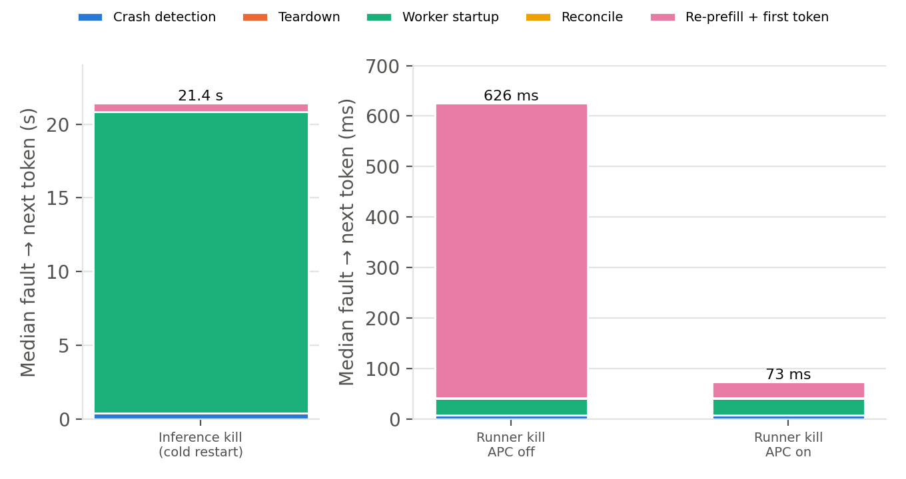

# Week 1 spike report

Lordphone Wen · 2026-11-03 · one RTX 5090 (32 GB, driver 580.178.04), pinned vLLM 0.32.0 cu129 image, Qwen3-4B BF16, `max_model_len` 32768. Raw data: [`results/20261103-rtx5090/`](results/20261103-rtx5090/) (2,598 telemetry events, all schema-valid); tables: [`summary.md`](results/20261103-rtx5090/summary.md). Every value is the median of 5 runs; σ is below 2% unless noted.

## Results

| Measurement | Result |
| --- | --- |
| Cold start (`WORKER_START_REQUESTED` → `WORKER_READY`) | **20.5 s** with weights in page cache, **22.2 s** from NVMe. **86 s** when the CUDA driver's JIT cache is empty (first start on a host). |
| Prefill, APC off (2K / 8K / 16K) | 90 ms / 452 ms / **1.09 s** (23K / 18K / 15K tok/s) |
| Prefill, APC on, same prefix again | 15 ms / 26 ms / **42 ms** (6.5×, 17.6×, 26× faster than the APC-on first request); vLLM reports all but the last partial 16-token block cached |
| Decode, single stream | **161 tok/s** at 2K context, 129 tok/s at 16K |
| Typical answer length on agent prompts | 660 tokens with thinking off, 1,598 with thinking on (σ ≈ 30%) |
| Recovery, inference process `kill -9` | **21.6 s** crash → next token: 20.4 s worker start, 0.6 s re-prefill of 10K tokens, 0.39 s detection |
| Recovery, runner `kill -9`, APC off | **625 ms**: 584 ms re-prefill, 33 ms runner restart, 7 ms detection, 1 ms log replay |
| Recovery, runner `kill -9`, APC on | **73 ms**: 31 ms re-prefill (cache hit), 33 ms runner restart |

Where the 20.5 s cold start goes (vLLM log timestamps for one start, diagnostic): about 0.2 s container start, 3.5 s API-server imports, 5 s engine-process spawn and config, 2 s weight load, 7.7 s engine init (5 s of it CUDA graph capture), and about 2 s of API-server setup before the first healthy `/health`. With an empty driver JIT cache, CUDA graph capture takes 70 s instead of 5 s.

## What this means for the RQ2 scope

These rows are the decision table from `docs/work-distribution.md`. Shirley makes the final call.

| If the spike shows | Measured | Then |
| --- | --- | --- |
| Cold start ≫ 16K prefill | Yes: 20.5 s vs 1.09 s (19×; 79× with an empty driver cache) | Warm replica failover becomes the main configuration, and cold restart is only a comparison |
| Decode throughput ≪ prefill throughput | Yes: 161 vs 15–23K tok/s (about 100×) | Decode checkpoints stay at Should. A lost decode token costs about 100 prefill tokens, and a thinking answer (about 1,600 tokens) is about 10 s of decode. |
| APC makes a repeated prefix much faster | Yes: 26× at 16K | The fault-domain split becomes RQ2's main line, and APC is a factor that must be reported |
| Runner-only recovery is almost all reconcile | No. With APC off it's 93% re-prefill; with APC on the whole recovery is 73 ms and reconcile is 1 ms. | Keep runner crash as a comparison arm, not a separate study. The APC-off runner arm is still useful because it isolates pure re-prefill cost. |

For context, a full restart at step 6 of the scripted task would also redo about 4 s of decode for five completed steps, before counting tool calls. Resume replaces that with about 0.6 s of re-prefill.

## Issues found

1. **The pinned image doesn't start as shipped.** It contains `torchcodec` 0.17.0 built for CUDA 13 (`libnvrtc.so.13`) next to a cu129 torch. The library load raises `OSError`, which `vllm/multimodal/media/audio.py` doesn't catch, so `vllm serve` crashes at import time on any host, including PSC. Fix: [`compat/torchcodec/`](compat/torchcodec/__init__.py) is mounted on `PYTHONPATH` and raises `ImportError` instead. That sends vLLM down its existing "torchcodec unavailable" path. The image itself is unchanged, and audio decoding isn't used.
2. **Driver JIT dominates first starts on Blackwell.** The image's kernels have no native sm_120 code, so the CUDA driver JIT-compiles their PTX, which costs about 65 s per start unless the cache in `/root/.nv` persists. The harness mounts that cache and raises `CUDA_CACHE_MAXSIZE` to 4 GB. Two consequences:
   - Every reported restart time must state whether the driver cache is warm. The harness now records it on every `WORKER_START_REQUESTED`.
   - A fresh node or replica pays the 86 s price once.
3. **Detection of an inference kill takes 387 ms.** That's mostly the `docker kill` CLI round trip before the stream breaks. A supervisor that watches the process directly would see the crash sooner. This doesn't change any conclusion, since detection is under 2% of the 21.6 s.

## Limits

- This is one consumer GPU that also drives a display, so numbers are reported as a separate platform and never pooled with PSC numbers. SM clock (median 2,850 MHz under load) and temperature (≤ 81 °C) were logged every 200 ms, and there was no throttling.
- Prompts are random token IDs, which give the same attention and MLP cost as text. Generated tokens are greedy with `ignore_eos`.
- Reconcile here is a replay of the local durable log. There's no tool service yet, so a real `query(op_id)` round trip will add to it.
- The agent loop is scripted: 8K prefix, 128 generated plus 256 tool tokens per step, crash after 64 tokens of step 6. Five runs per cell, against the plan's ≥ 20 for reported performance cells.
- The decode-checkpoint and warm-replica numbers aren't measured yet. A warm replica on this machine has to share the one GPU with the primary instance.
